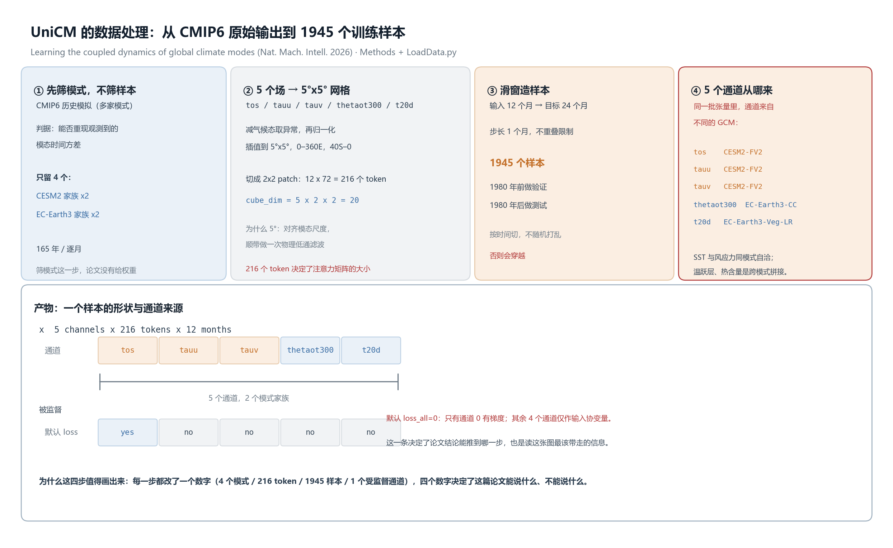
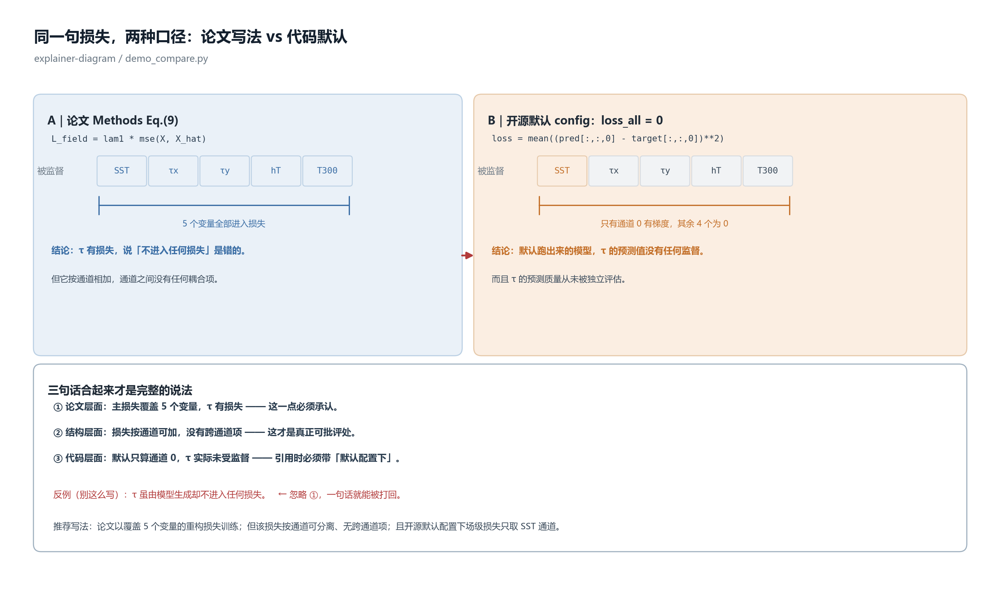
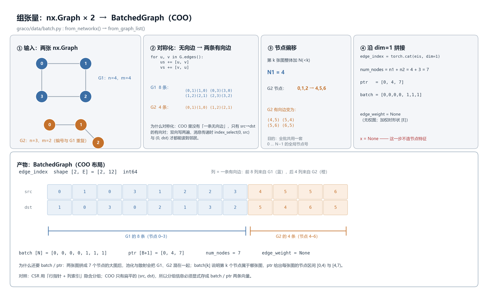

# explainer-diagram-v2

Turn an explanation into **one annotated figure** — with real shapes, real values, and a
"why this step" line on the image itself — then have the renderer **measure its own layout**
(text overlap, missing glyphs, off-canvas boxes) before you ever look at it.



*A figure produced by this kit: 4 GCMs → 216 patch tokens → 1945 samples → 1 supervised channel.
Every box carries a number you can check against the code.*

## Why another diagram helper

Flowcharts made of boxes and arrows survive any paper and are needed by none: the reader leaves
with "there are three steps" and nothing else. The judgment that replaces taste:

> Erase every word in the figure, keep numbers and shapes. If what remains still supports your
> conclusion, the figure is fine. If nothing remains, it was typography.

This kit encodes that judgment: ten layout archetypes, fifteen primitives, inch coordinates, and
a measured QA pass. It is a matplotlib wrapper, not a drawing app — you drive it from Python.

## Quick start

```bash
git clone https://github.com/Master-640/explainer-diagram-v2.git
pip install matplotlib
python scripts/demo_compare.py      # writes demo_compare.png, prints QA: PASS
```

Use it from your own script:

```python
import sys
sys.path.insert(0, "<repo>/scripts")
from diagram_kit import PALETTE, Canvas

c = Canvas()                                   # 15.2 x 9.2 inch, 160 dpi
c.title("同一件事，两种画法", "left: flowchart, right: explanation")
c.box(0.30, 1.75, 6.60, 4.30, "A｜只有框和箭头", tint="grey")
c.tensor_grid(9.05, 4.50, [["tos", "tauu", "tauv", "thetaot300", "t20d"]],
              row_labels=["通道"],
              tints=["orange", "orange", "orange", "blue", "blue"])
c.why(0.35, 1.05, "判据：擦掉文字只留数字和形状，还能不能支持结论。")
c.save("fig.png")                              # prints the QA report
```

`save()` prints `QA: PASS` or `QA: NEEDS FIX` with an itemized report. Fix coordinates, re-run,
then open the PNG once by eye.

## Ten archetypes

| # | Archetype | Use when | Main primitives |
|---|---|---|---|
| M1 | data flow / tensor layout | input is reshaped into a tensor; shapes and real indices matter | `box` `tensor_grid` `bracket` |
| M2 | architecture / module wiring | layers, deploy boundaries, call edges | `lane` `box` `arrow` `elbow` |
| M3 | pipeline with artifacts | every step drops a file; the artifact is the story | `box` + artifact band |
| M4 | A/B comparison | paper vs code, before vs after, option A vs B | two `box` + paired `tensor_grid` + `callout` |
| M5 | timeline / milestones | schedule, each point has an acceptance test | `timeline` |
| M6 | state machine / decision tree | finite states, transition conditions | `node_graph(directed=True)` |
| M7 | hierarchy | one parent, several children; vocabulary, ownership | `tree` |
| M8 | single-cell zoom | "where does this one row come from" | `box` + leader line + zoom frame |
| M9 | causal loop | positive/negative feedback (Bjerknes, control loops) | `node_graph` ring + signs |
| M10 | annotated chart | conclusion comes from a real curve, key points marked | native plot + `callout` |
| M11 | step cards (in / out / code / example) | explain what each pipeline step does; reader verifies against the source | 4 cards + bottom product band + `callout` |

One figure, one claim. More than 4 sequential steps or more than 2 parallel objects → split it.

## Primitives

`box` `lane` `chip` `arrow` `elbow` `node_graph` `tensor_grid` `timeline` `tree` `bracket`
`callout` `legend` `kv_lines` `footnote` `why` — plus `title` `text` `save` `qa` `report`.

`why(x, y, text)` draws the single most valuable line on the figure: why this step exists.
Full signatures are in the docstrings of `scripts/diagram_kit.py`.

## Measured QA

Three checks, all measured rather than eyeballed:

| Check | Rule |
|---|---|
| overlap | two text bboxes, each shrunk 10%, still intersect with area > 4 px² |
| missing glyph | `FT2Font.get_char_index` plus matplotlib's own `Glyph N missing` warnings |
| off-canvas | bbox extends past the canvas by more than 2 px |

The glyph check needs both halves: the font-table lookup alone misses `₁ ₂ ⚠`, which only
surface as renderer warnings.

Honest caveat from the author: the first version of this QA reported `PASS` on a figure whose
titles were printed on top of the body text, because `box()` drew its title with a raw `ax.text`
that never entered the tracked-text list. After routing it through the single entry point, the
same figure immediately reported 5 real overlaps. A self-check only checks what you remembered
to register.

## Gallery

| | |
|---|---|
|  |  |
| `demo_compare.py` — paper formula vs code default, paired grids | two `nx.Graph`s into one COO tensor, with the real 2×12 grid |

## Repository layout

```
SKILL.md              the spec: archetypes, workflow, primitives, six iron rules, QA section
references/           style spec, per-archetype recipes, QA checklist, a worked case study
scripts/diagram_kit.py    the renderer (Canvas, 15 primitives, qa(), report())
scripts/demo_*.py         runnable examples, one per archetype family
scripts/example_obs_features.py   a real-world case: graph batch + state → x[N,3]
examples/             rendered PNGs referenced by this README
```

## Requirements and limits

- Python 3.7+, matplotlib >= 3.4, and a CJK font (Microsoft YaHei, SimHei, or Noto Sans CJK).
- It draws **structure**, not data. Scatter, heatmap, line, map → seaborn / Cartopy.
- Coordinates are inches and are written by hand. There is no auto-layout; the payoff is that
  nothing shifts when you resize or change the font size.
- One-off figures are faster by hand. This pays off from the fifth figure onward, when the same
  skeleton gets reused with different content.

## 中文简介

把一段解释变成**一张带真实数值的标注图**，渲染完自动检查版式（文字重叠、缺字、越界），
不靠眼睛猜坐标。十个图型（数据流、架构、流水线、A/B 对比、时间线、状态机、层次、单点放大、
因果环、标注图表），十五个构件，坐标以英寸为单位。

判据只有一句：把图里所有文字擦掉，只留数字和形状，剩下的东西还能不能支持你的结论。

```bash
python scripts/demo_compare.py     # 出一张对比图，控制台打印 QA: PASS
```

## License

MIT. See [LICENSE](LICENSE).
